# Cloud Forensics Lab: Recovering Deleted Evidence from Versioned Object Storage

A hands-on lab that answers one practical question: **when an attacker uploads a file to cloud storage, "renames" it and deletes it, can an investigator still prove what happened and recover the original content?**

I built a three-machine environment around MinIO, an S3-compatible object store, with object versioning enabled. A Kali Linux machine plays the attacker. An Ubuntu machine plays the forensic analyst. Every step is documented with the exact commands and a screenshot.

This lab is the practical part of my seminar paper **"Cloud Digital Forensics: Beyond Tools, Techniques, and Challenges"** for the Digital Forensics course in the Cybersecurity program at AAB College (Prishtinë). The paper is written in Albanian. This README explains the lab in English.

---

## Summary

| | |
|---|---|
| **What I did** | Built a private "cloud" with MinIO, simulated an attacker who hides their tracks by copying and deleting a file, then investigated it as a forensic analyst. |
| **Why I did it** | Cloud investigations cannot rely on seizing a disk. I wanted to see for myself what evidence the platform keeps, instead of only reading about it. |
| **What it solves** | It removes the assumption that "deleted" means "gone" in a versioned bucket, and gives a repeatable procedure for listing, recovering and verifying deleted objects. |
| **Result** | A normal read of the deleted file fails. A version-aware investigation recovered the original payload, and the recovered files matched the original content. |

---

## Table of contents

1. [Why this matters](#1-why-this-matters)
2. [Key concepts in plain language](#2-key-concepts-in-plain-language)
3. [Lab architecture](#3-lab-architecture)
4. [Setup](#4-setup)
5. [Walkthrough with evidence](#5-walkthrough-with-evidence)
6. [Reading the evidence as an investigator](#6-reading-the-evidence-as-an-investigator)
7. [Results](#7-results)
8. [What I learned](#8-what-i-learned)
9. [Limitations and what I did not verify](#9-limitations-and-what-i-did-not-verify)
10. [Why this project is worth looking at](#10-why-this-project-is-worth-looking-at)
11. [Ideas for extending it](#11-ideas-for-extending-it)
12. [Repository layout](#12-repository-layout)
13. [References](#13-references)
14. [Responsible use, author and license](#14-responsible-use-author-and-license)

---

## 1. Why this matters

In a classic investigation I can image a disk, hash it and examine it. In the cloud this is usually not possible:

- **I have no physical access.** The provider controls the hardware, so evidence collection depends on what the platform exposes: logs, snapshots and object history.
- **Deletion looks final.** If I list a bucket normally after an attacker has deleted a file, I see nothing. A careless investigator could conclude the evidence is gone.
- **Chain of custody is harder.** Every action needs a verifiable record of who did what, when, and to which version of which object.

My paper reviews these challenges using the literature (Ruan et al. 2011, NISTIR 8006 and others). This lab tests one concrete part of that discussion: what the storage layer itself preserves when someone tries to erase their tracks.

---

## 2. Key concepts in plain language

Think of a versioned bucket as a **ledger**. Every write adds a new line. A delete does not erase earlier lines. It adds a line that says "deleted".

| Term | Meaning in this lab |
|---|---|
| **Object versioning** | The bucket keeps every version of an object instead of overwriting it. This is the setting the whole lab depends on. |
| **Version ID** | A unique identifier for one specific version of an object. It lets me address an old version directly. |
| **Delete marker** | A zero-data version that records a delete. It hides the object from normal reads but removes nothing. |
| **ETag** | A value MinIO stores for the object content, used here for consistency checks. |
| **"Rename" in S3** | There is no real rename. A rename is a **copy to the new name, then a delete of the old name**. This is why an attacker who renames leaves two trails. |
| **`mc`** | The MinIO Client, a command-line tool for talking to MinIO and other S3-compatible storage. |

---

## 3. Lab architecture

Three virtual machines on one private subnet, simulating a private cloud:

```
 ┌──────────────────┐        ┌───────────────────────────┐        ┌────────────────────┐
 │  Attacker        │        │  MinIO server (Ubuntu)    │        │  Forensic analyst  │
 │  Kali Linux      │  S3    │  Bucket: cloud-forensics- │   S3   │  Ubuntu            │
 │  mc alias:       ├───────▶│  lab (versioning ON)      │◀───────┤  mc alias: minio   │
 │  attacker        │ :9000  │  API :9000, Console :9001 │ :9000  │                    │
 └──────────────────┘        └───────────────────────────┘        └────────────────────┘
```

| Role | OS | What it does |
|---|---|---|
| MinIO server | Ubuntu | Stores the objects. Versioning is enabled on the bucket `cloud-forensics-lab`. API on port 9000, web console on port 9001. |
| Attacker | Kali Linux | Uploads, copies and deletes objects with `mc`, trying to hide the activity. |
| Forensic analyst | Ubuntu | Has authorized access. Lists versions, attempts reads, recovers objects by version ID. |

---

## 4. Setup

### Prerequisites

- A MinIO server that both client machines can reach on the API port (9000).
- The MinIO Client (`mc`) installed on the attacker and analyst machines.
- Credentials of your own. Never commit them to the repository.
- An isolated lab network.

### Step 1. Start MinIO

My lab used a dedicated Ubuntu VM. If you prefer a container, this is a common way to run MinIO locally. It is not how I built my lab and I have not tested this exact command, so treat it as a starting point:

```bash
docker run -p 9000:9000 -p 9001:9001 \
  -e MINIO_ROOT_USER=<choose-a-user> \
  -e MINIO_ROOT_PASSWORD=<choose-a-strong-password> \
  quay.io/minio/minio server /data --console-address ":9001"
```

Open the console at `http://<MINIO_IP>:9001` to confirm the server is running.

### Step 2. Configure `mc` aliases

On the analyst machine:

```bash
mc alias set minio http://<MINIO_IP>:9000 <ANALYST_ACCESS_KEY> <ANALYST_SECRET_KEY>
```

On the attacker machine:

```bash
mc alias set attacker http://<MINIO_IP>:9000 <ATTACKER_ACCESS_KEY> <ATTACKER_SECRET_KEY>
```

### Step 3. Create the bucket and enable versioning

Run once as the analyst or administrator:

```bash
mc mb minio/cloud-forensics-lab
mc version enable minio/cloud-forensics-lab
```

Versioning must be on **before** the attacker acts. Without it, a delete is final and the rest of the lab does not work.

---

## 5. Walkthrough with evidence

Each step shows what I ran, what happened, and the screenshot from my run. Screenshots are in [`docs/images/`](docs/images/).

### Step 0. The lab is running

The MinIO web console shows the server configuration and the service ports (API 9000, console 9001). This confirms the environment is up before any activity starts.

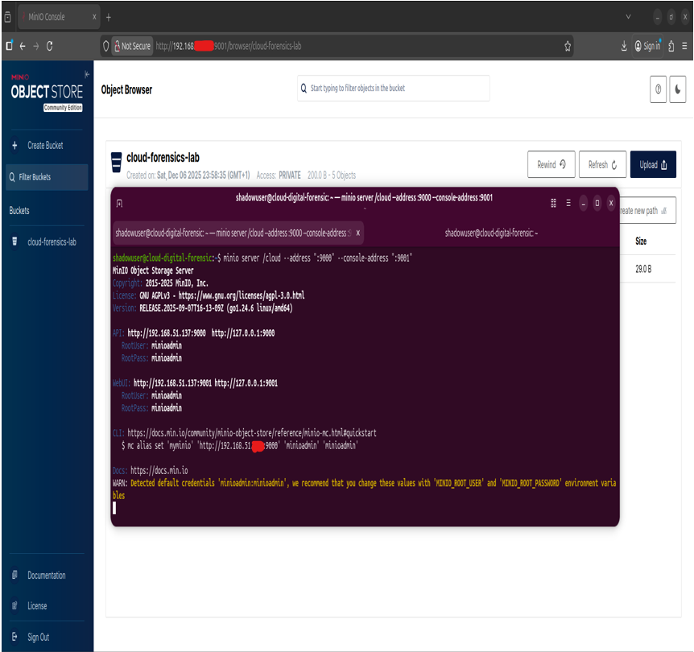

### Step 1. The attacker uploads a payload

On Kali, the attacker creates a small file and uploads it to the bucket:

```bash
echo 'NEW_TEST_PAYLOAD_001' > attackfile.txt
mc cp attackfile.txt attacker/cloud-forensics-lab
```

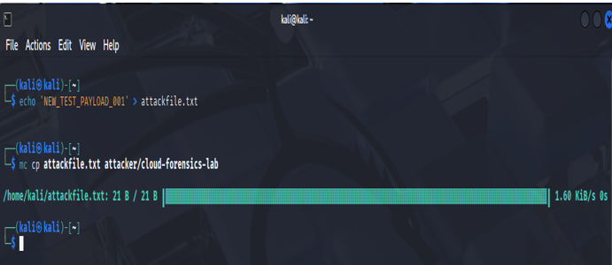

The upload automatically creates **version 1 (PUT)** of `attackfile.txt`. The file is visible on the server:

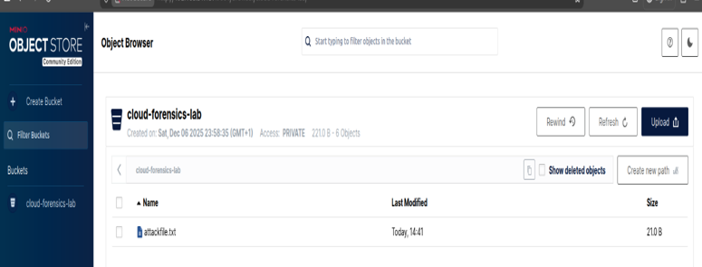

### Step 2. The attacker "renames" and deletes the file to hide it

S3 has no rename, so the attacker copies the object to a new name and deletes the original:

```bash
mc cp attacker/cloud-forensics-lab/attackfile.txt attacker/cloud-forensics-lab/renamed_attackfile.txt
mc rm attacker/cloud-forensics-lab/attackfile.txt
```

`mc rm` reports that it created a **delete marker** and prints its version ID. It does not remove the earlier version.

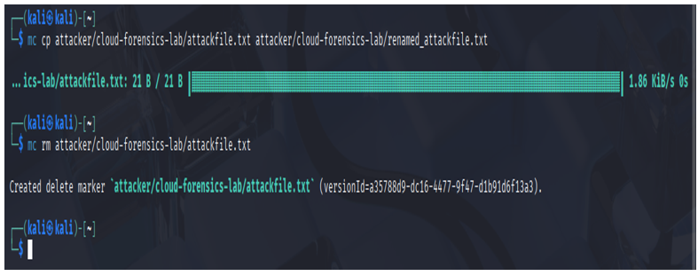

The copy is itself a new write, so MinIO records its metadata. The object panel shows the **size**, the **Version ID**, the **Last Modified** timestamp and the **ETag**. These fields are what the analyst will use later.


### Step 3. The attacker deletes the renamed copy

To remove the last visible trace, the attacker deletes the renamed object too:

```bash
mc rm attacker/cloud-forensics-lab/renamed_attackfile.txt
```

This creates a second delete marker. To a normal user the bucket now looks empty.

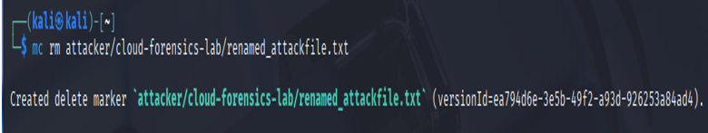

### Step 4. The analyst lists every version

From here I switch to the analyst machine. The first move is a version-aware listing:

```bash
mc ls minio/cloud-forensics-lab --versions
```

The output shows each version with its Version ID, timestamp, size, and whether it is a `PUT` or a `DEL` (delete marker).

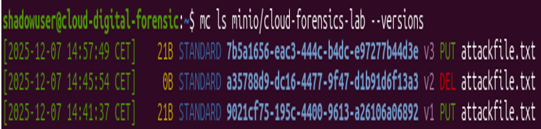

### Step 5. A normal read fails

This step shows why a careless investigation goes wrong. A normal read of the deleted object fails, because the latest version is a delete marker:

```bash
mc cat minio/cloud-forensics-lab/attackfile.txt
```

Result: `Object does not exist`.

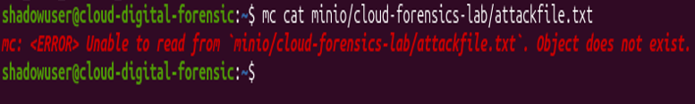

Reading the delete marker directly by its version ID also fails, because a delete marker holds no data:

```bash
mc cat --version-id <DELETE_MARKER_VERSION_ID> minio/cloud-forensics-lab/attackfile.txt
```

Result: `The specified method is not allowed against this resource`.

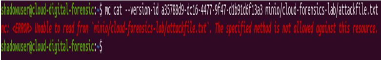

### Step 6. The analyst recovers the original version

The data is not in the delete marker. It is in the earlier `PUT` version. The analyst copies that version out by its version ID:

```bash
mc cp --version-id <PUT_VERSION_ID> minio/cloud-forensics-lab/attackfile.txt recovered_attackfile_v1.txt
```

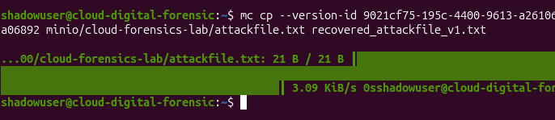

### Step 7. The analyst verifies the history

After recovery, the analyst checks that the history is intact and then lists all versions again to confirm that the recovery changed nothing in the bucket.

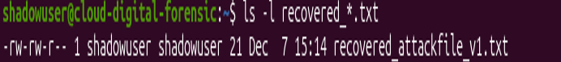

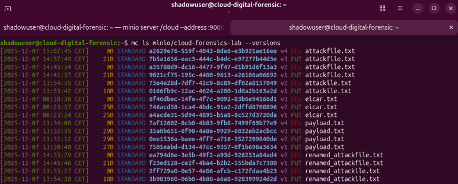

### Step 8. Recovery of the evidence, including the renamed object

The same recovery is repeated for the evidence file and for the renamed object, each using its own version ID:

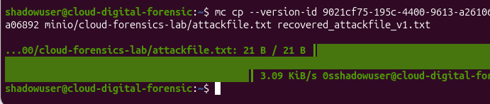

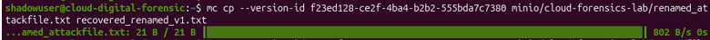

### Step 9. Integrity verification

The recovered files are listed and their content is checked by hand. Both contain the original payload `NEW_TEST_PAYLOAD_001`:

```bash
ls -l recovered_*.txt
cat recovered_attackfile_v1.txt
cat recovered_renamed_v1.txt
```

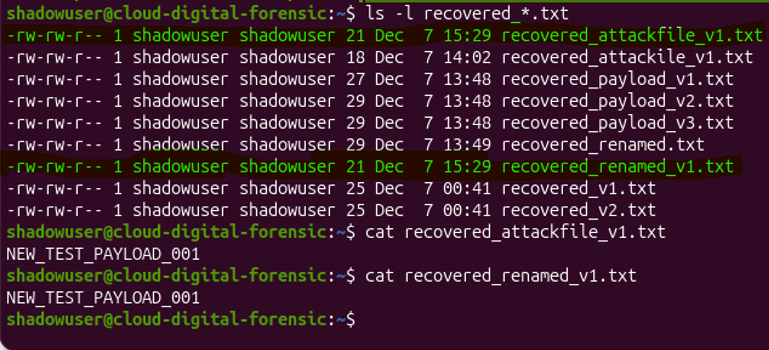

Optional step that I did not do in this run: record a `sha256sum` of each recovered file and the time of recovery in the investigation notes.

---

## 6. Reading the evidence as an investigator

From the version listing, the analyst can rebuild the attacker's timeline without ever seeing the files in a normal listing:

| Order | Event | Evidence in the listing |
|---|---|---|
| 1 | `attackfile.txt` uploaded | `PUT` version with its own Version ID, timestamp and size |
| 2 | File copied to `renamed_attackfile.txt` | New `PUT` version under the new name |
| 3 | `attackfile.txt` deleted | `DEL` marker with its own Version ID and timestamp |
| 4 | `renamed_attackfile.txt` deleted | Second `DEL` marker with its own Version ID and timestamp |

What each piece tells me:

- **Delete markers hold no content, but they are evidence.** They show that a delete happened, when, and on which object. The pattern copy, delete, delete points to a deliberate attempt to hide something.
- **A rename leaves two trails.** Because it is copy plus delete, the attacker created a new version and a delete marker, not a clean disappearance.
- **Version ID, Last Modified, size and ETag work together.** The ID identifies the version, the timestamp places it in time, and size and ETag support a consistency check of the recovered content.

---

## 7. Results

| Observation | Result |
|---|---|
| Normal read of the deleted object | Failed: `Object does not exist` |
| Read of the delete marker by version ID | Failed: delete markers contain no data |
| Version-aware listing | Showed all `PUT` versions and `DEL` markers with IDs and timestamps |
| Recovery by version ID | Succeeded for the original object and for the renamed object |
| Content of recovered files | Both contained `NEW_TEST_PAYLOAD_001`, identical to what the attacker uploaded |

**Conclusion for this scenario:** with versioning enabled before the incident, deleting and "renaming" an object did not destroy the evidence. It created more of it.

---

## 8. What I learned

1. **The investigator has to know to ask for versions.** The evidence was in the bucket the whole time, but only a version-aware query revealed it. A normal listing would have suggested there was nothing to investigate.
2. **Delete markers deserve the same attention as data.** They carry intent and timing even though they hold no content.
3. **Forensic readiness has to exist before the incident.** The lab worked because versioning was already on. Turning it on after the attacker acted would not bring anything back.
4. **Role separation changes what survives.** The attacker could upload and delete. The analyst could inspect history and recover. How permissions are split decides what an attacker can destroy.
5. **A "rename" is not a clean operation in object storage.** Understanding that it is copy plus delete changes how I read the timeline.
6. **Exact commands and outputs are part of the evidence.** Documenting every step is what makes the result repeatable and reviewable.

---

## 9. Limitations and what I did not verify

I state these openly so a reader does not have to discover them.

| Topic | Status |
|---|---|
| **Versioning is not immutability** | In this scenario the attacker's deletes produced delete markers. My lab does not document the attacker's permission policy. A user who is allowed to delete specific versions can remove them permanently. Real deployments need **Object Lock (WORM)** and tightly scoped delete permissions. **Not tested.** |
| **One scenario, one payload** | One bucket and one small test file. It demonstrates the mechanism and does not measure anything at scale. |
| **MinIO as an analogue** | MinIO is S3-compatible and the behavior shown follows the standard versioning model. I **did not test** AWS S3, Google Cloud Storage or Azure Blob Storage. |
| **Integrity checking was basic** | I used the ETag, the size and a manual comparison of content. For single-part uploads the ETag is typically MD5-based, which is fine for consistency checks but is not a strong forensic hash. A real case needs SHA-256 hashing and a documented chain of custody. |
| **The analyst had administrative access** | In a real investigation, getting that access from the provider through the legal process is much of the difficulty. This lab does not cover it. |
| **Case study chapter in the paper** | The paper also contains a generic insider-attack case study on an IaaS platform. It is a written walkthrough, **not an experiment I ran**. Only the MinIO lab in this repository was executed. |
| **Environment specifics** | Hostnames, IP addresses and credentials from my lab are not part of this repository. |

---

## 10. Why this project is worth looking at

- **It is small enough to rebuild in an evening** and see the behavior with your own eyes.
- **It turns a claim into checkable steps.** "Cloud evidence can survive deletion" becomes commands, outputs and screenshots.
- **It exposes the gap between "deleted" and "gone".** That gap matters for incident response, insider-threat cases and audit design.
- **It is honest about its limits.** The limitations table says what was and was not tested, so the result can be trusted for what it actually shows.
- **It is a base for further work.** See the next section.

---

## 11. Ideas for extending it

- Enable **Object Lock** and test whether an attacker who can delete versions is stopped.
- Turn on **MinIO audit logging** and correlate the log with the version history.
- **Script the timeline reconstruction** from `mc ls --versions` output.
- Add **SHA-256 hashing** and a chain-of-custody template to the recovery step.
- Repeat the scenario on **AWS S3 with CloudTrail data events** to compare with MinIO.

---

## 12. Repository layout

```
cloud-forensics-minio-lab/
├── README.md        This file
├── LICENSE          MIT
└── docs/
    └── images/      Screenshots from my lab run, referenced in section 5
```

---

## 13. References

- Ruan, K., Carthy, J., Kechadi, T., & Crosbie, M. (2011). *Cloud forensics: An overview.* IFIP International Conference on Digital Forensics. https://dl.ifip.org/db/conf/ifip11-9/df2011/RuanCKC11.pdf
- Herman, M., Grance, T., & Kent, K. (2020). *NIST Cloud Computing Forensic Science Challenges* (NISTIR 8006). https://nvlpubs.nist.gov/nistpubs/ir/2020/NIST.IR.8006.pdf
- Simou, S., Kalloniatis, C., Gritzalis, S., & Mouratidis, H. (2016). *A survey on cloud forensics challenges and solutions.* Security and Privacy, 9(2), e1688.
- Purnaye, S., Kulkarni, S., & Pawar, A. (2021). *A comprehensive study of cloud forensics.* IJIRCCE, 9(3), 2218 to 2224.
- Malik, A. W., Bhatti, D. S., Park, T.-J., Ishtiaq, H. U., & Kim, K.-I. (2024). *Cloud Digital Forensics: Beyond Tools, Techniques, and Challenges.* Sensors, 24(1).

---

## 14. Responsible use, author and license

**Responsible use.** Run this only on systems you own or are authorized to test, on an isolated network. The "attacker" actions are ordinary object uploads and deletes against my own lab server. No exploit code is included.

**Author.** Edison Bujupi, cybersecurity graduate, Prishtinë, Kosovo. GitHub: [EdisonBujupi](https://github.com/EdisonBujupi)

**Course.** Digital Forensics, Cybersecurity program, AAB College.

**License.** Released under the MIT License. See [LICENSE](LICENSE).
